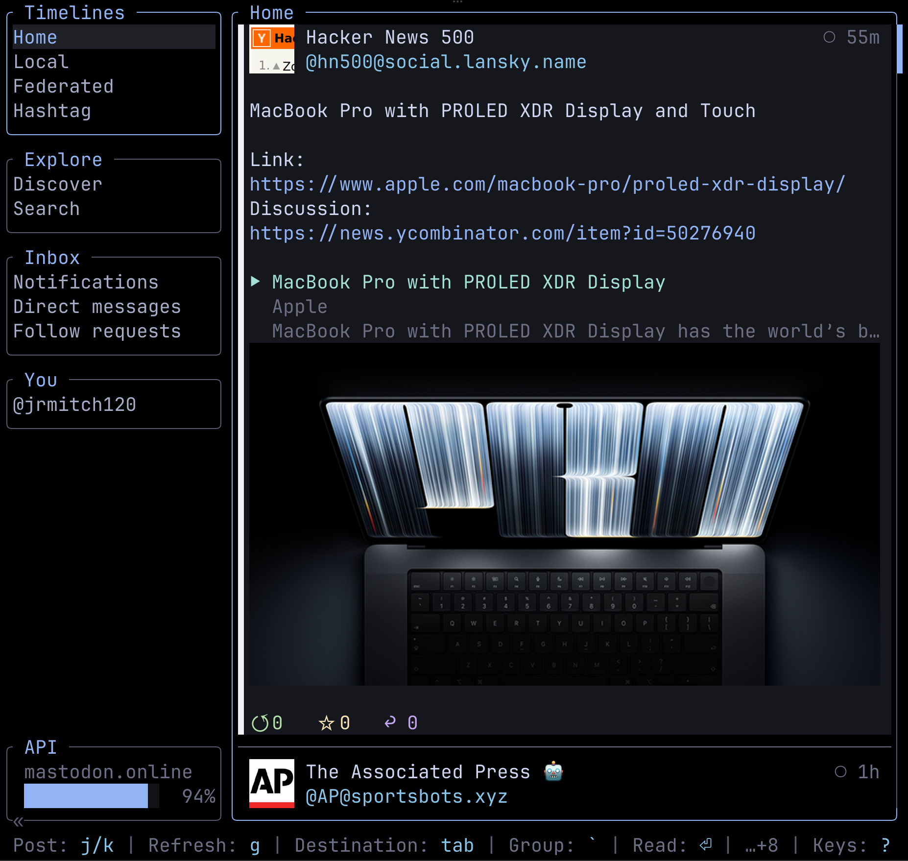
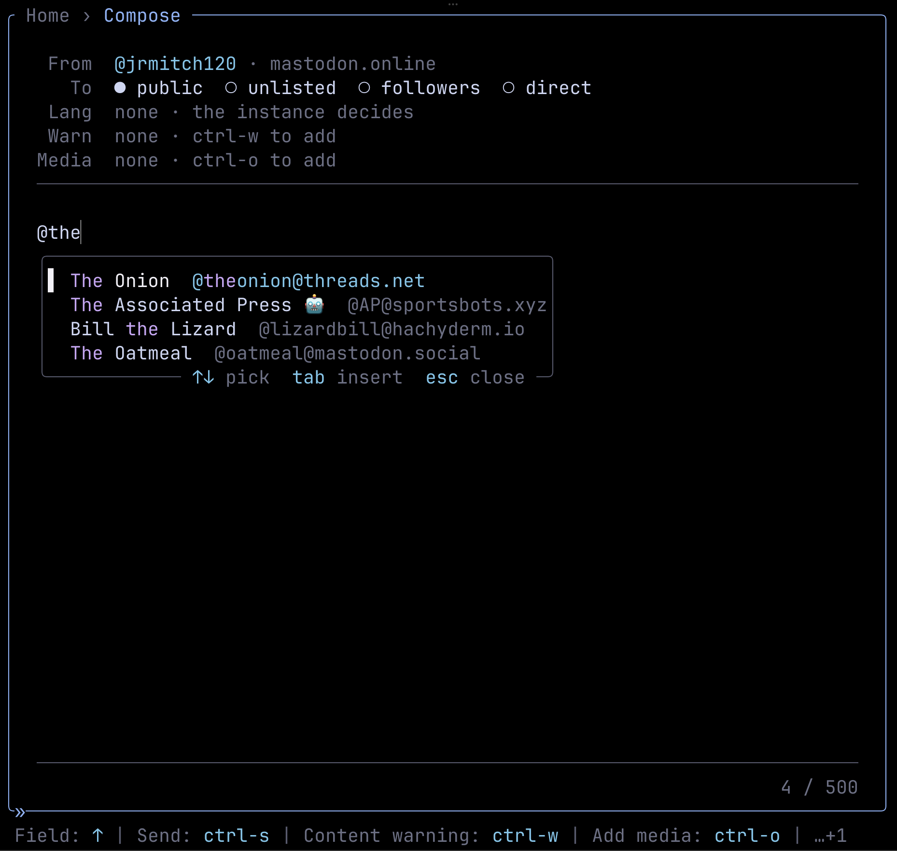
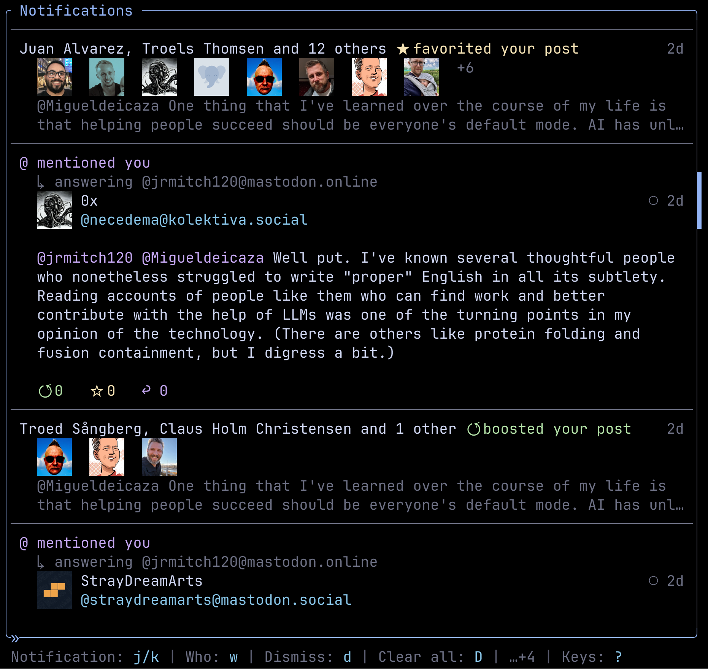
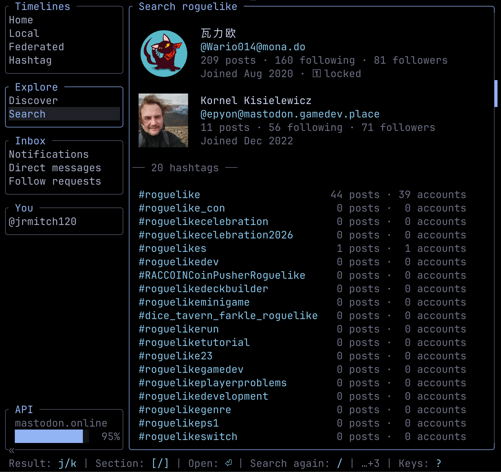

# Wooly

A cross-platform terminal client for Mastodon, written in .NET. Wooly comes as two programs that share one API, sign-in
and config layer:

- **`wooly-tui`**, an interactive, keyboard-driven shell for reading and posting.
- **`wooly-cli`**, a scriptable command line with JSON output and stable exit codes.

Sign in once and both of them act as the same profile.

## Screenshots

| | |
|---|---|
|  |  |
| The home timeline, with pictures drawn inline | Compose, with the mention picker |
|  |  |
| Notifications, grouped by post | One search across accounts and hashtags |

## Features

**Both front ends**

- Home, local, federated and hashtag timelines, plus any account's posts, replies and pinned posts
- Write, reply to, edit and delete posts, with content warnings, attachments and alt text, polls, visibility and language
- Boost, favorite, pin, and vote in polls
- Notifications, direct messages, and follow requests for a locked account
- Follow, mute and block accounts, and edit your own public profile
- One search across accounts, hashtags and posts
- Several profiles, across one instance or many, with a default and a per-run `--profile` override
- Sign-in through your browser (OAuth). Wooly never asks for your password.

**The TUI**

- A rail of destinations (Timelines, Hashtags, Explore, Inbox, You) beside a content panel, with a breadcrumb you walk
  back out of with `esc`
- Tag sets: a name for a few hashtags, followed on the rail as one timeline of the posts carrying any of them
- Pictures drawn inline on terminals that speak sixel or the Kitty graphics protocol, and linked with their alt text
  everywhere else. Video and audio open in your own player.
- Live unread counts on the Inbox, kept up to date by the instance's streaming API, with an optional bell
- Compose on its own screen, with mention and language pickers, a file browser for attachments, and pasting pictures or
  files from the clipboard
- Mouse support, an adjustable shell width, a hideable rail, and themes you can write yourself in the config file
- Works without colour too: `NO_COLOR` and `TERM=dumb` are respected

**The CLI**

- `--json` on lists, searches, shown posts and accounts, and what you publish. A list comes as an envelope that says
  whether the fetch was complete.
- Errors on stderr, results on stdout, and documented exit codes for scripts to branch on

## Install

Download the executable for your platform from the
[latest release](https://github.com/jrmitch120/wooly/releases/latest). Each one is a single self-contained file, so you
don't need .NET installed.

| Platform | TUI | CLI |
|---|---|---|
| Linux x64 | `wooly-tui-linux-x64.tar.gz` | `wooly-cli-linux-x64.tar.gz` |
| macOS Apple silicon | `wooly-tui-macos-arm64.tar.gz` | `wooly-cli-macos-arm64.tar.gz` |
| macOS Intel | `wooly-tui-macos-x64.tar.gz` | `wooly-cli-macos-x64.tar.gz` |
| Windows x64 | `wooly-tui-windows-x64.exe` | `wooly-cli-windows-x64.exe` |

On Linux and macOS, unpack the tarball and run what's inside:

```sh
tar -xzf wooly-tui-macos-arm64.tar.gz
./wooly-tui
```

A couple of things your machine still needs to supply:

- **Linux:** the ICU libraries (`libicu`). Desktop and server distributions usually have them; minimal container images
  usually don't.
- **macOS:** the builds aren't signed or notarized. Extracting with `tar` on the command line is usually enough to get
  past Gatekeeper. If macOS still refuses, clear the quarantine flag with
  `xattr -d com.apple.quarantine ./wooly-tui`.

## Getting started

### In the TUI

Run `wooly-tui`. With no profile set up yet, it opens on **Add a profile**: type your instance (for example
`mastodon.social`), sign in through the browser it opens, and give the profile a name. You land on your home timeline.

Press `?` on any screen to see its keys. `ctrl-p` opens the profiles screen, where you can add, switch, sign in again or
remove a profile.

### From the CLI

```sh
wooly-cli profile add work --instance mastodon.social
```

This opens your browser to authorize Wooly, then checks the token against the instance before saving the profile. On a
machine with no browser, the address is printed so you can finish signing in somewhere else. If you already have an
access token, pass it with `--token <TOKEN>`, or use `--manual` to be asked to paste one.

The first profile you add becomes the default. Every command acts as the default unless you pass `--profile <NAME>`,
and `wooly-cli profile switch <NAME>` changes which one that is. `wooly-tui --profile <NAME>` works the same way for a
single session.

## Using the TUI

The status row at the bottom always shows the current screen's keys, and `?` lists all of them. The ones that work
everywhere:

| Key | Does |
|---|---|
| `tab` / `shift-tab` | Move down or up the rail of destinations |
| `` ` `` / `~` | Jump to the next or previous rail group |
| `esc` | Go back one level (never quits) |
| `/` | Search |
| `ctrl-p` | Profiles |
| `\` | Hide or show the rail |
| `-` / `+` | Narrow or widen the shell |
| `?` | Keys for this screen |
| `ctrl-q` | Quit |

On a timeline or a post:

| Key | Does |
|---|---|
| `j` / `k` | Next / previous post |
| `↓` / `↑`, `PgDn` / `PgUp` | Scroll without moving the selection |
| `⏎` | Open the post |
| `a` | Open the author's account |
| `c` / `r` | Compose / reply |
| `b` / `f` | Boost / favorite (and undo) |
| `e` / `d` / `p` | Edit / delete / pin your own post |
| `w` | Who favorited or boosted it |
| `x` | Show what a content warning is hiding |
| `←` / `→` | Walk the hashtags, mentions and links in the post |
| `1`–`9`, `0`, then `v` | Pick poll options, then vote |
| `g` | Refresh |

When composing, `ctrl-s` sends, `esc` discards (asking first if you've typed anything), `ctrl-w` moves between the post
and its content warning, `ctrl-o` opens the file browser, and `ctrl-v` or `alt-v` attaches a picture or files from the
clipboard.

The full contract for every screen, key and theme role is in [docs/tui-shell.md](docs/tui-shell.md).

## Using the CLI

`wooly-cli --help` lists every command, and `wooly-cli <command> --help` shows its options. The command groups:

| Command | For |
|---|---|
| `profile` | `add`, `list`, `show`, `switch` and `remove` local profiles |
| `timeline` | `home`, `local`, `federated`, `tag`, `account` and `pinned` |
| `post` | `create`, `reply`, `edit`, `delete`, `show`, `boost`, `favorite`, `pin`, `vote`, `favorited-by`, `boosted-by`, and their undos |
| `account` | `show`, `edit`, `follow`, `unfollow`, `followers`, `following`, `block`, `mute` (and undos), and `requests list/accept/reject` |
| `notification` | `list`, `dismiss` and `clear` |
| `dm` | `list`, `show`, `send` and `read` |
| `search` | Accounts, hashtags and posts, or one kind with `--type` |
| `version` | Print the version |

Some examples:

```sh
# The 40 newest posts on your home timeline, as JSON
wooly-cli timeline home --limit 40 --json

# A post with a content warning and a described picture
wooly-cli post create "Look who turned up" --cw "cat pics" --media "cat.png:a ginger cat asleep on a keyboard"

# A poll that stays open for two days
wooly-cli post create "Tabs or spaces?" --poll tabs --poll spaces --poll-open 2d

# A direct message
wooly-cli dm send alice@example.social "Are we still on for Thursday?"

# Search for a hashtag
wooly-cli search "#dotnet"
```

Lists fetch 20 items by default; `--limit` asks for more, paging through the instance for you.

### Exit codes

Scripts can rely on these. New codes may be added, but existing ones won't change meaning.

| Code | Meaning |
|---|---|
| `0` | Success |
| `1` | General error |
| `2` | Usage error, including an option Wooly doesn't have |
| `3` | Authentication error |
| `4` | Network error |
| `5` | Rate limited |

Errors always go to stderr. A rate limit fails straight away instead of waiting, and a list cut short by one still
prints what it got, with `"complete": false` in the JSON.

## Configuration

Wooly keeps its files in a `wooly` folder under your platform's application data directory:

| Platform | Location |
|---|---|
| Linux | `~/.config/wooly/` |
| macOS | `~/Library/Application Support/wooly/` |
| Windows | `%APPDATA%\wooly\` |

`config.toml` holds your profiles and preferences and is meant to be edited by hand. Access tokens are never written to
it. They go in your OS keyring (Keychain, Windows Credential Manager, or Secret Service on Linux). On macOS and Linux
the keyring is reached through Git's credential manager, so it needs `git` on your `PATH`. Where no keyring is
available, such as a headless server, tokens fall back to a plaintext `credentials.toml` beside the config, and Wooly
warns you when that happens.

The preferences you're most likely to want:

```toml
theme = "dark"                # "dark", "light", or one of your own below

[preferences]
default_visibility = "public" # public, unlisted, followers or direct
default_language = "en"
bell = true                   # ring when an Inbox badge rises
hide_drawn_caption = false    # hide a picture's caption once it's drawn
shell_width = 100             # 50 to 100, a percentage of the terminal
hidden_rail = false
scrollbar = "block"           # block, line, left-half, right-half or none

# Each tag set is a place on the TUI rail's Hashtags group: up to twelve tags, read as one timeline.
[[tag_sets]]
name = "dotnet"
tags = ["dotnet", "csharp", "fsharp"]

# A theme only needs the roles it changes; the rest come from the built-in one.
[themes.midnight]
body = "#d5d2e0"
link = "#8fa8ff"
```

Changing the shell width or hiding the rail from inside the TUI rewrites this file, so comments you've added by hand
won't survive. Every theme role, and how the fallbacks work, is listed in [docs/tui-shell.md](docs/tui-shell.md#a-theme).

## Building from source

You need the [.NET 10 SDK](https://dotnet.microsoft.com/download).

```sh
git clone https://github.com/jrmitch120/wooly.git
cd wooly
dotnet build

# Run either front end
dotnet run --project src/Wooly.Tui
dotnet run --project src/Wooly.Cli -- timeline home
```

Wooly uses ImageSharp 4.x, which wants a Six Labors licence key at build time. A Debug build only warns without one, so a
fresh clone builds and tests fine. A Release build fails without it; to build Release locally, put the key in a
`sixlabors.lic` file at the repository root. Git ignores that file.

### Tests

```sh
dotnet test
```

The default run is the fast unit suite and talks to no network. There's also an integration suite that runs against a
real Mastodon instance in Docker:

```sh
tests/integration/run.sh
```

That seeds a throwaway instance, runs the suite and tears it down again. CI runs both on every pull request.

## Project layout

| Path | What's there |
|---|---|
| `src/Wooly.Core` | The shared layer: the Mastodon API client (via [Mastonet](https://github.com/glacasa/Mastonet)), profiles, credentials, config |
| `src/Wooly.Tui` | The TUI, built on [Terminal.Gui](https://github.com/gui-cs/Terminal.Gui) |
| `src/Wooly.Cli` | The CLI, built on [Spectre.Console](https://spectreconsole.net/) |
| `tests/Wooly.Tests` | Unit and integration tests (xUnit) |
| `docs/adr` | Architecture decision records: why things are the way they are |
| `docs/tui-shell.md` | The TUI's screens, keys, roles and themes |
| `GLOSSARY.md` | The project's vocabulary |

## Contributing

Bugs and ideas are tracked as [GitHub issues](https://github.com/jrmitch120/wooly/issues). Before changing something,
it's worth reading:

- **[GLOSSARY.md](GLOSSARY.md).** Wooly is careful with its words. It says "post", never "status" or "toot", and the
  glossary defines the rest.
- **[docs/adr](docs/adr).** The decisions already made and the reasons behind them, so a change can build on them or
  argue with them directly.

The build treats warnings as errors and enforces code style, so `dotnet build` and `dotnet test` passing locally is a
good sign CI will pass too.

## Licence

[MIT](LICENSE) © Jeff Mitchell
